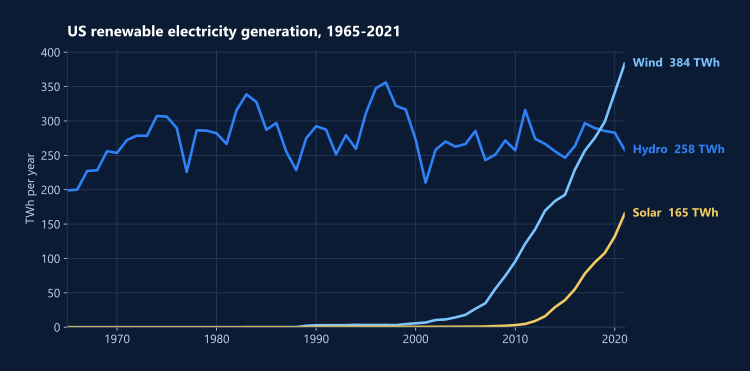

<div align="center">


</div>

How has US renewable electricity changed over 57 years, and what patterns can machine learning find in it? This project merges 17 public datasets into one view of US solar, wind, hydro, biofuel and geothermal energy from 1965 to 2021. It then runs a full sequence of methods on that view: exploration, clustering, association rules, classification and regression.

## Highlights

- **Wind passed hydro in 2019.** Wind generation reached 298.9 TWh against hydro's 285.5 TWh. By 2021 wind was at 383.6 TWh.
- **Solar grew 55x in eleven years,** from 3.0 TWh in 2010 to 165.4 TWh in 2021.
- **Two clear eras.** K-Means finds the cleanest split at k=2, with a silhouette score of 0.881: the hydro-dominated decades, and the wind and solar build-out.
- **Eight notebooks, two languages.** The analysis runs in Python, with R for hierarchical clustering and association rules.



## Approach

| Step | Notebook | Methods |
| --- | --- | --- |
| 1. Wrangle and explore | `01_data_wrangling_and_eda` | Merge 17 CSVs, isolate the US, check gaps and duplicates; trend, scatter, stacked-area and correlation plots |
| 2. Find structure | `02a_kmeans_clustering`, `02b_hierarchical_clustering_r`, `02c_association_rules_r` | K-Means with silhouette analysis, hierarchical clustering (cosine distance), Apriori association rules |
| 3. Classify and regress | `03a_decision_trees`, `03b_naive_bayes` | Decision-tree regression and Naive Bayes on binned generation for solar, wind and hydro |
| 4. Model generation | `04_svm_regression` | SVM regression with linear, RBF and polynomial kernels, plus an extrapolation to 2034 |
| 5. Live data | `05_eia_api` | Pull annual totals from the US Energy Information Administration API |

## Limitations

- **The extrapolation to 2034 is a modeling exercise, not a projection.** In notebook 4, the SVM extrapolation starts below the latest actuals: 50.8 TWh of solar for 2024, against 165.4 TWh actually generated in 2021.
- **Some tests are tiny.** The Naive Bayes test set has only 12 years, so its accuracies (0.33 to 0.75) swing widely.

## Repository

```
notebooks/        the analysis, in order (01 to 05)
data/raw/         the 17 source CSV files
data/             merged_usa_dataset.csv (the US view) and merged_total_dataset.csv (all countries)
assets/           chart and banner used in this README
```

## Run it

The notebooks were written in Google Colab and read data from Drive paths such as `/content/drive/MyDrive/ML_Project/`. Point those at `data/` when running locally.

```
pip install -r requirements.txt
jupyter notebook notebooks/
```

The two R notebooks need an R kernel (IRkernel) with `arules` and `arulesViz`. Notebook 5 reads a free EIA key from the `EIA_API_KEY` environment variable; you can get one at https://www.eia.gov/opendata/.
